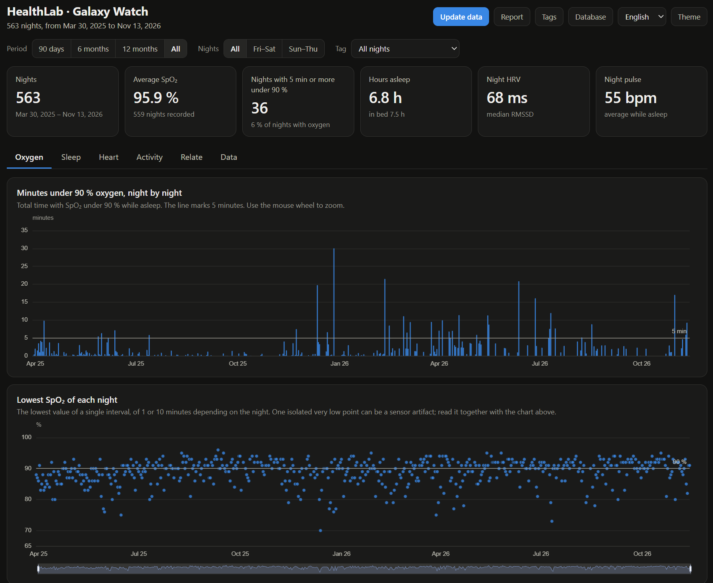
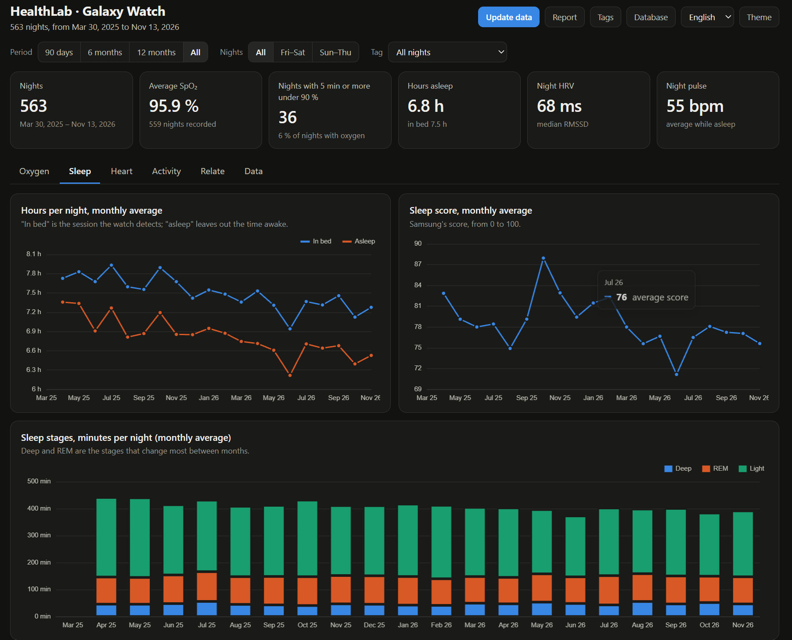
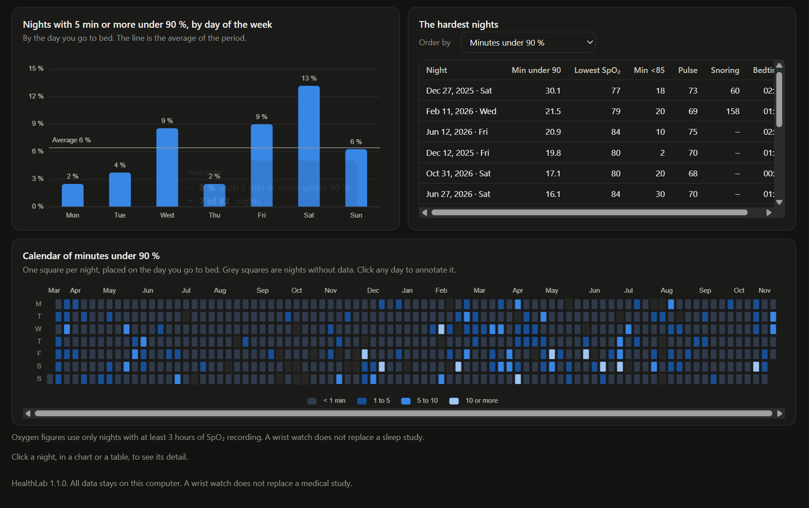

# HealthLab

[Español](README.es.md)

Windows desktop app that imports Samsung Health exports, accumulates them in a local database, and lets you analyse and relate Samsung Watch Ultra data.

All data stays on your computer. The app does not send anything to any service. It shows trends from a wrist watch and does not replace a medical evaluation.

## Overview

HealthLab is a local-first Python desktop application (version 1.1.0). You bring a Samsung Health export as a `.zip`, preview what would change, and merge it into a DuckDB database that never leaves the machine. From there you can explore nights and days, tag dates, compare two nights, and generate a PDF report to take to a clinician.

Until version 1.0.1 the app was called MiSalud. The packaged folder was built and tested on Windows on 18 November 2026.

The full user manual, architecture and design decisions are in [`docs/`](docs/) (in Spanish).

## Key features

- **Import with a preview.** Choose a Samsung Health `.zip`, wait for a preview (nothing is saved yet), then confirm or cancel. New records are added; updated records keep the previous value in history; missing records are kept. Invalid records (for example an impossible date) are rejected and logged.
- **Nothing is lost.** Each new export is merged into what is already stored. Before every merge the app backs up the database and keeps the two most recent backups. Original zip files are kept under `data/exports`.
- **Six views**, all sharing the same filters (period, weeknights vs weekend, and tag): Oxygen, Sleep, Heart, Activity, Relate, and Data.
  - **Oxygen:** minutes under 90 % SpO₂ night by night, lowest SpO₂ of each night, weekday patterns, a sortable table of the hardest nights, and a calendar. Oxygen figures use only nights with at least 3 hours of recording.
  - **Sleep, Heart and Activity:** hours asleep, efficiency and stages; pulse and HRV during sleep; steps, active minutes, stress, and a typical day by hour.
  - **Relate:** pick two metrics and see a night-by-night scatter with a Spearman correlation. Metrics that start with "Day" belong to the day the night began. A correlation does not prove causation.
  - **Data:** a night-by-night table, with a CSV download for Excel.
- **Night detail.** Click a night in any chart or table to open up to eight tracks on the same time axis: sleep stages, oxygen, pulse, variability (RMSSD), snoring, breathing, skin temperature and movement. Orange bands mark intervals under 90 % SpO₂. You can zoom with the mouse wheel and compare two nights, aligned by clock time or by hours since falling asleep.
- **Day screen.** From a date, see pulse, stress, steps, recorded exercise and sleep from 0 to 24 hours.
- **Tags and notes.** Mark a date with yes/no tags (alcohol, late dinner, nasal congestion, nap, illness, travel, medication, intense training, or tags you create) and an optional free-text note. Filter views by tag, and compare nights with and without one.
- **PDF report for a clinician.** An A4 PDF that always opens with the night oxygen summary and closes with method notes and data limitations. Optional blocks: Heart, Sleep, Snoring, Activity, Day and night, and Annotations. You can include the watch model, optional personal details in the header, and up to two nights in detail. The app does not send the PDF anywhere.
- **Database panel.** Last import, data coverage, database size, app version, import history, validation issues, backups with restore, and a button to open the data folder.
- **Spanish or English**, light or dark theme. The choice is remembered.
- **Portable Windows folder.** Distributed as `HealthLab.exe` plus its `_internal` files. No installer required.

## Tech stack

| Area | What the repo uses |
|---|---|
| Language | Python 3.12 or newer |
| Database | DuckDB (`data/salud.duckdb`) |
| Data | pandas |
| Desktop UI | pywebview, with a local HTML/CSS/JS page and [Apache ECharts](https://echarts.apache.org/) (no web server, no open ports) |
| PDF reports | ReportLab |
| Windows package | PyInstaller (`release/build_windows.bat`) |
| Quality | Ruff (format and lint), mypy in strict mode, pytest with coverage |

The code in `src/healthlab/` is organised in layers (`config`, `reading`, `transform`, `storage`, `derived`, `annotations`, `queries`, `pipeline`, `reports`, `interface`). A layer may import only the layers below it; `tests/test_architecture.py` enforces that rule.

## Privacy

Everything lives in the app folder, under `data/`: the database, backups, original export zips and logs. That folder is not under version control.

The app does not connect to the internet or send data to any service. The window talks to Python directly, without a web server or open ports. Sharing a PDF or copying the `data` folder is your decision.

The user manual recommends keeping the app folder out of Program Files and out of cloud-synced directories (OneDrive, Google Drive), so health data is not uploaded by the sync client and the database is not touched while the app is open.

## Getting started

### Requirements

- Python 3.12 or newer
- For the packaged app: Windows 10 or 11, 64-bit. The window needs Microsoft WebView2, which comes with Windows 11 and with Edge.

### Run from source

```
pip install ".[ui]"
healthlab
```

The `healthlab` command opens the desktop window (`healthlab.interface.window:main`).

### Development environment

```
python -m venv .venv
.venv\Scripts\activate
pip install -e ".[dev]"
```

On Linux or macOS, activate the virtual environment with `source .venv/bin/activate` instead of `.venv\Scripts\activate`.

### Quality checks

These four commands should finish without errors:

```
ruff format --check .
ruff check .
mypy
pytest
```

| Tool | What it checks |
|---|---|
| `ruff format` | Consistent code formatting |
| `ruff check` | Style, common errors, function documentation, and size limits (complexity 10 and 40 statements) |
| `mypy` | Types, in strict mode |
| `pytest` | Automated tests, with coverage |

### Build the Windows folder

How to produce `HealthLab.exe` is documented in [`docs/build_windows.md`](docs/build_windows.md). In short, double-click `release\build_windows.bat` on a Windows machine (Python is needed only to build; the resulting folder runs without it). To build, verify and install in one step:

```
release\build_windows.bat --install C:\HealthLab
```

That replaces `HealthLab.exe`, `_internal`, `Manual.md`, `LICENSE.txt` and `THIRD_PARTY_LICENSES.txt`, and leaves the `data` folder untouched.

## Usage

How to use the app day to day is in [`docs/manual.md`](docs/manual.md). The short version:

### Export from Samsung Health

1. On the phone, open **Samsung Health**.
2. Open the three-dot menu, then **Settings**.
3. Find **Download personal data** and confirm. It may take a few minutes.
4. The phone leaves a folder named `samsunghealth_…` under `Download/Samsung Health`.
5. Copy that folder to the computer.
6. If it is not already a `.zip`, right-click the folder and choose **Compress to ZIP file**.

Menu names can change between Samsung Health versions. Each export contains the full history, so exporting about once a month is enough.

### Import into HealthLab

1. Open HealthLab and choose **Update data** (the first time, **Choose the Samsung Health file**).
2. Select the `.zip` file.
3. Wait for the **preview**. Nothing has been saved yet.
4. Read the preview and choose **Confirm and import**, or **Cancel**.

The preview counts new, updated, unchanged, kept and rejected records per table, and can warn if the export is older than the last import, if records older than 30 days changed, or if Samsung's format changed for a table.

## Project structure

```
src/healthlab/    application code, organised in layers (see docs/architecture.md)
tests/            automated tests
tests/support/    synthetic export in the Samsung Health format
release/          Windows folder build (see docs/build_windows.md)
docs/             user manual, architecture, data dictionary, merge rules and decisions
data/             database, backups and original zips; not under version control
```

## Screenshots

**Oxygen view**: minutes under 90 % SpO₂ night by night and the lowest SpO₂ of each night.



**Sleep view**: hours per night, sleep score and sleep stages by month.



**Weekday patterns, hardest nights and oxygen calendar.**



## Disclaimer

HealthLab shows trends from a wrist watch. It is not a medical device, it does not diagnose, and it does not replace a clinical evaluation. A correlation between two metrics does not prove that one causes the other. Use the reports as a starting point for a conversation with a healthcare professional.

## License

Copyright 2026 Juan Jose Gimenez.

HealthLab is distributed under the [PolyForm Noncommercial License 1.0.0](LICENSE). You may use, copy, modify and share it for noncommercial purposes: personal use, study, research, and use by educational, public-health or non-profit organisations. Any commercial use requires a separate permission from the author.

Anyone who shares the program or a modified version must also include the `LICENSE` file, with its `Required Notice` line.

Third-party components keep their own licenses:

| Component | License | Where |
|---|---|---|
| Apache ECharts | Apache 2.0 | `src/healthlab/interface/web/vendor/`, with its notice |
| Python libraries (DuckDB, pandas, ReportLab, pywebview and their dependencies) | Each library's own | Installed separately; the Windows folder ships them and lists them in `THIRD_PARTY_LICENSES.txt` |

## Author

[Juan José Giménez](https://github.com/JuanJGimenez) · [LinkedIn](https://www.linkedin.com/in/juan-jos%C3%A9-gim%C3%A9nez-1a77ba175/)
